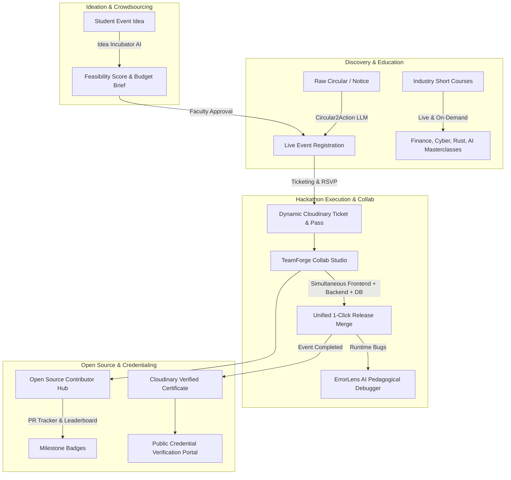

# 🎟️ EventHub AI — Notion Project Documentation & Hackathon Pitch

> **Hacktober HackDays 2026 Submission**  
> **Evaluation Breakdown:** 50% Problem Statement & Solution | 30% Cloudinary Integration | 20% Notion Documentation  
> **Live Local Application:** `http://localhost:5001`  
> **Full-Stack Architecture:** Node.js + Express + React 18 + Tailwind CSS + Cloudinary Programmable Media + Multi-Module LLM Intelligence

---

## 📌 1. Executive Summary

**EventHub AI** is an end-to-end collegiate event and open-source operating system. It transforms how universities organize competitions, empower students to propose ideas, upskill through essential industry short courses (Finance, Programming, Cybersecurity), collaborate simultaneously in dev teams, and issue tamper-proof edge credentials.

### Why this is a standout submission:
1. **50% Problem & Solution:** Addresses 6 authentic campus pain points with working software:
   - **Circular2Action AI Notice Extractor:** Converts 5-page bureaucratic notices into live events.
   - **Idea Incubator & Faculty Pipeline:** Turns student proposals into approved live events.
   - **Online Lectures Hub:** Curated live webinars and on-demand courses (Finance for engineers, Cybersecurity, Rust).
   - **Ticketing & RSVP System:** Pricing tiers, promo codes (`HACKTOBER50`), and dynamic ticket generation.
   - **Open-Source Contributor Hub:** Live PR tracker, good-first-issue feed, mentor directory, and gamified leaderboard.
   - **TeamForge Collab Studio:** Real-time simultaneous frontend, backend, and database workspace with one-click merging.
   - **ErrorLens AI Tutor:** Explains compiler/runtime errors pedagogically without spoon-feeding answers.
2. **30% Cloudinary Integration:** Cloudinary is used extensively across 5 distinct programmable media vectors:
   - Dynamic edge-rendered certificates with multi-layer text overlays.
   - Dynamic admission tickets with barcodes, seat tiers, and QR verification codes.
   - Milestone open-source badges (First PR Merged, Git Master, Cloudinary Wizard).
   - AI content-aware responsive cropping (`g_auto` for 16:9, 4:3, and 9:16 aspect ratios).
   - Cloudinary video streaming (`vc_auto,q_auto,w_1280`) for online lectures.
3. **20% Notion Documentation:** A clean, exhaustive, structured retrospective on thought process, system design, architectural decisions, and learnings.

---

## 🏆 2. Problem Statement & Solution Architecture (50% Evaluation)

### The 6 Broken Realities of Campus Events & Developer Communities

### Detailed Breakdown of Solution Modules:

#### 1. Ticketing & RSVP Engine
* **Problem:** University event forms either use fragile Google Forms or disconnected ticketing portals with zero verification.
* **Solution:**
  - Clear pricing tiers (*Student Free RSVP*, *VIP Hackathon Pass*, *Team Pack*).
  - Discount promo codes (e.g. `HACKTOBER50` for 50% off, `COMMUNITYFREE` for 100% off).
  - **Manual & Instant Ticket Generation:** Compiles an official admission pass directly on Cloudinary with barcodes, pass IDs, and check-in QR codes.
  - Social sharing to Twitter/X, WhatsApp, and LinkedIn.
  - Interactive FAQ answering dress code, refund policies, Wi-Fi specs, and accessibility details.

#### 2. Online Lectures & Short Courses (Live vs. On-Demand)
* **Problem:** Students miss vital professional topics not taught in the traditional university curriculum (Personal Finance, Startup Equity, Cybersecurity CTFs, Modern Systems Programming).
* **Solution:**
  - Dedicated hub categorized into **Live Upcoming Streams** and **On-Demand Video Courses**.
  - Courses on Personal Finance & Startup Equity for Engineers, Defensive Cyber Zero Trust, Modern Rust, and Cloudinary Media AI.
  - Video player powered by Cloudinary optimized video delivery (`vc_auto,q_auto,w_1280`).

#### 3. Open-Source Contributor Hub & PR Tracker
* **Problem:** Beginners want to contribute during Hacktoberfest but get overwhelmed finding friendly repositories or tracking their contributions.
* **Solution:**
  - **Open Source Portfolio Link:** Connect GitHub and GitLab handles directly to the student profile.
  - **Live PR Tracker:** Tracks PRs submitted and merged during hackathons.
  - **Milestone Badges:** Automatic Cloudinary badge generation (*"First Pull Request Merged"*, *"Git Master"*, *"Cloudinary Media Wizard"*).
  - **Good First Issue Feed:** Curated feed of beginner-friendly tasks with bounty points.
  - **Git Cheat Sheets & Etiquette Guide:** Markdown rules for writing PR descriptions that maintainers merge.
  - **Active Mentor Directory:** Connects students with maintainers via Discord for debugging help.
  - **Live Leaderboard:** Gamified ranking of top student contributors.

#### 4. TeamForge Simultaneous Collaborative Dev Studio
* **Problem:** During hackathons, team members work in isolated tabs across GitHub, Postman, Figma, and SQL consoles. Merging at the last minute causes painful integration errors.
* **Solution:**
  - Unified workspace where team members simultaneously work on:
    - **Frontend:** React + Tailwind UI components
    - **Backend:** Express API routes & middleware
    - **Database:** PostgreSQL schemas & migrations
    - **Tasks:** Live Kanban task tracker
  - **1-Click "Merge Team Workspaces":** Validates and compiles the three layers into a single synchronized build artifact.

#### 5. ErrorLens AI Debugger & Platform Navigator
* **Problem:** Beginners blindly paste error messages into chatbots and get copy-pasted fixes without understanding *why* the error happened.
* **Solution:**
  - Explains the **root cause** in plain language.
  - Pinpoints the **faulty location** and variable.
  - Gives a **pedagogical hint** before showing the solution to stimulate critical thinking.
  - Provides the **corrected code** with an explanation of why the fix works.
  - Asks a **follow-up understanding check question** to test comprehension.
  - Answers platform doubts regarding tickets, certificates, and event rules.

#### 6. Idea Incubator & Faculty Approval Pipeline
* **Problem:** Creative student event proposals get lost in WhatsApp chats or rejected by faculty for lack of budget justification.
* **Solution:**
  - Students submit event concepts.
  - AI Co-Pilot generates an **AI Feasibility Score (1-100)**, itemized budget breakdown, and formal faculty pitch.
  - Faculty coordinators (e.g. *Dr. Priya Nair*) can review, approve, or click **"🚀 Launch Live Event"** to turn proposals into active events!

#### 7. Circular2Action Notice Extractor
* **Problem:** University circulars are dense 5-page PDFs. Students miss deadlines and eligibility rules.
* **Solution:** LLM extracts deadlines, team limits, prize money, and rules, generating live event forms instantly.

---

## ☁️ 3. Cloudinary Integration Matrix (30% Evaluation)

| Cloudinary Feature | Implementation in EventHub | Innovation & Value Add |
| :--- | :--- | :--- |
| **Dynamic Multi-Layer Text Overlays** | Verified Certificates (`generateCertificateUrl`) | **Zero Server Load:** Replaces heavy Node.js Puppeteer/Canvas rendering. Overlays recipient name in `Playfair Display`, title in `Cinzel`, credential ID, and verification seal directly on the CDN. |
| **Dynamic Admission Tickets** | Event Passes (`generateTicketUrl`) | Bakes attendee name, ticket code (`TCK-8819`), pricing tier stamp, and barcode onto a high-res ticket pass on the fly. |
| **Milestone Open-Source Badges** | Achievement Badges (`generateMilestoneBadgeUrl`) | Generates circular gold/elite badges (`First PR Merged`, `Git Master`) with the recipient's name dynamically embedded. |
| **AI Content-Aware Cropping (`g_auto`)** | Event Posters & Banners (`generateResponsiveBanners`) | Detects subjects and automatically reformats event posters into 16:9 hero banners, 4:3 cards, and 9:16 mobile story formats. |
| **Adaptive Video Streaming** | Online Lectures & Masterclasses (`generateLectureVideoUrl`) | Automatically selects optimal video codec and bitrate (`vc_auto,q_auto,w_1280`) for smooth mobile lecture viewing. |
| **Interactive Transformation Playground** | Judge Sandbox (`CloudinaryShowcase.jsx`) | Lets judges customize names, roles, and fonts to watch live Cloudinary URL transformations compile in real time! |

---

## 🛠️ 4. Technical Architecture & Key Decisions (20% Evaluation)

### Tech Stack Rationale
- **Frontend:** React 18 + Vite + Tailwind CSS. Sub-second build times and fluid responsive mobile navigation.
- **Backend:** Node.js + Express. Fast, lightweight handling of asynchronous media transformations and LLM tasks.
- **Cloudinary SDK:** Configured with fallback demo transformations, ensuring the app runs out of the box with zero external friction while also connecting live credentials when provided.
- **State Store:** Persistent JSON store with deep seed data for events, lectures, proposals, open-source repos, and team workspaces.

---

## 🎯 5. Hackathon Live Demo Walkthrough for Judges

1. **Role Switcher (Top Right):** Switch between Student (Aarav), Faculty (Dr. Priya Nair), and Organizer (Rohan Mehta).
2. **Events & Ticketing:** Select any event -> choose pricing tier -> apply promo code `HACKTOBER50` -> click Confirm RSVP -> view generated **Cloudinary Admission Ticket**.
3. **Online Lectures:** Switch between Live streams and On-Demand modules (Finance, Cybersecurity, Rust). Click "Watch Lecture" to see the Cloudinary streaming player.
4. **Open Source Hub:** Connect GitHub profile -> view live PR counter -> explore `good-first-issues` -> check the live Leaderboard.
5. **TeamForge Collab Studio:** Switch between Frontend, Backend, Database, and Tasks -> click **"🚀 Merge Team Workspaces"** to compile all three layers into a single release!
6. **ErrorLens AI Tutor:** Paste any runtime error -> click "Diagnose Error" -> review root cause, pedagogical hint, and follow-up test question.
7. **Idea Incubator:** Propose an idea -> run AI Feasibility Scorer -> switch to Faculty -> Approve & Launch Live Event!
8. **Cloudinary Matrix:** Test custom names in the live transformation playground.
9. **Public Certificate Verifier:** Verify credential `EH-2026-X89B` with cryptographic seal proof.
